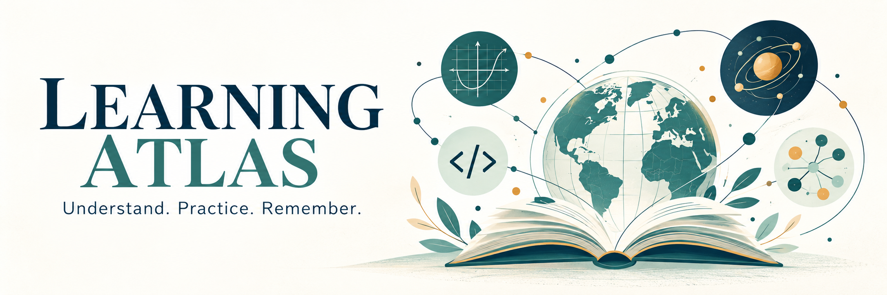
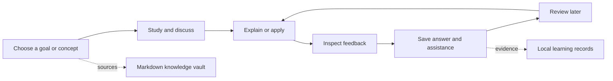

# Learning Atlas · All Of Computing

**A personal learning workspace that remembers your studies—and keeps evidence of what you can explain and apply.**

[](https://github.com/hammadshakeelai/all-of-computing/actions/workflows/checks.yml)
[](docs/GETTING-STARTED.md)
[](LICENSE)
[](docs/ARCHITECTURE.md)

[Get started](docs/GETTING-STARTED.md) · [Scope](docs/SCOPE.md) · [Research](docs/research/2026-10-06-scope-discovery.md) · [Roadmap](docs/ROADMAP.md) · [Latest release](https://github.com/hammadshakeelai/all-of-computing/releases/latest)

You have notes, courses, tools, and things you half remember. Learning Atlas brings them into a local workspace: study a concept, answer a question, inspect feedback, save the evidence, and return for review. Your Markdown library and your demonstrated ability stay connected, with separate records.

**The first learning scope is computer science and AI, centered on a BSAI degree.** The underlying system supports other subjects too. University syllabus, semester, available time, and current proficiency still need to be established; the [scope map](docs/SCOPE.md) is a proposed starting framework.

## Run locally

Python 3.11+ is the only runtime requirement. No third-party packages or account are needed for offline practice.

```sh
git clone https://github.com/hammadshakeelai/all-of-computing.git
cd all-of-computing
python server.py --open
```

Open [127.0.0.1:8765](http://127.0.0.1:8765). On Windows, double-click `start.cmd` or use `py -3 server.py --open`. On macOS/Linux, use `python3` if needed. Keep the terminal running during study. [Setup, optional AI, Obsidian, and recovery instructions →](docs/GETTING-STARTED.md)

## One learning loop



Reading a note or finishing a course records exposure. Independent answers and delayed practice provide different evidence. Missing evidence means **unknown**, rather than failure.

## What works today

| Workspace | Included in v1 |
| --- | --- |
| Study | Saved text conversations, explanations, hints, short/theory answers, applied text walkthroughs |
| Optional AI | OpenAI tutoring, quiz generation, answer feedback, and reviewable lesson drafts |
| Feedback | Frozen questions and references, original answers, assistance records, self-assessment and disputes |
| Library | Markdown import/edit, lexical search, sources, prerequisites, and an Obsidian-compatible vault |
| Planning | Manual courses/resources, ordered learning paths, outcomes, and time budgets |
| Review and graph | Due queue, transparent review intervals, prerequisite graph, evidence overlays |
| Ownership | SQLite records, JSON export/merge restore, checksums, and pre-restore snapshots |

Cloud AI starts disabled. Offline practice uses explicit self-assessment; it does not automatically grade the meaning of your answer. The graph displays up to 24 concepts at a time. Read aloud depends on browser speech support.

**Current limits:** voice input, code execution, PDFs, semantic embeddings, automatic course synchronization, multi-device sync, and installers are future work. Retrieval currently searches concept notes with SQLite FTS5. The coordinator has bounded teaching roles; it is not an unrestricted autonomous agent.

No live paid AI call or educational grading calibration has been completed. Provider behavior is tested with mocks. Evidence labels and review intervals are transparent prototype rules, not validated proficiency certificates. [Full release and verification notes →](docs/RELEASE.md)

## Scope before more features

Initial research recommends making the **diagnose → practice → inspect feedback → review** loop reliable before expanding integrations. Obsidian, Anki, existing curricula, and document-chat tools already cover useful parts of the ecosystem; this project focuses on linking learning activities to inspectable evidence. This recommendation comes from a preliminary source review rather than demonstrated market demand. [Sources and reasoning →](docs/research/2026-10-06-scope-discovery.md)

The personal pilot starts with one measurable CS/AI outcome, a small concept set, and a recall-first diagnostic. Existing knowledge can shorten the path when supported by evidence. Broader interests stay in an exploration backlog. [Personal scope worksheet →](docs/PERSONAL-SCOPE.md)

## Your data

Personal records live in `private/`, which Git ignores. Open `private/vault` in Obsidian and use **Refresh vault** after external edits. JSON backups include assessment history; Markdown alone does not.

Optional cloud tutoring sends selected notes, recent dialogue, and answers to OpenAI after you enable it. The API key stays in the process environment. Review [setup and privacy details](docs/GETTING-STARTED.md#optional-openai-tutoring) before enabling it. This release runs for one trusted local user on loopback; it is not configured for public hosting.

## Explore the repository

| I want to… | Start here |
| --- | --- |
| Use the app | [Getting started](docs/GETTING-STARTED.md) |
| Understand the CS/AI and product boundary | [Scope](docs/SCOPE.md) |
| Find my own starting point | [Personal scope worksheet](docs/PERSONAL-SCOPE.md) |
| Read the evidence and tool comparison | [Initial research](docs/research/2026-10-06-scope-discovery.md) |
| Choose a few CS/AI sources | [Starting resources](docs/RESOURCES.md) |
| See what comes next | [Roadmap](docs/ROADMAP.md) |
| Understand storage and implementation | [Architecture](docs/ARCHITECTURE.md) |
| Browse the detailed original proposal | [Project plan](docs/PROJECT-PLAN.md) |
| Check what was verified | [Release notes](docs/RELEASE.md) |
| Contribute | [Contributing](CONTRIBUTING.md) · [Security](SECURITY.md) |

## Develop

```sh
python -m unittest discover -s tests -v
python -m compileall -q learning server.py
node --check web/app.js
```

Node is needed only for the JavaScript check. CI tests Python 3.11 and 3.13 on Windows and Linux. Keep synthetic test records separate from personal data. See [contribution guidelines](CONTRIBUTING.md) for changes to grading, retrieval, and storage.

Application code and original example material use the [MIT license](LICENSE). External courses and resources retain their own licenses. The [banner provenance](docs/brand/BANNER.md) documents the generated artwork.
