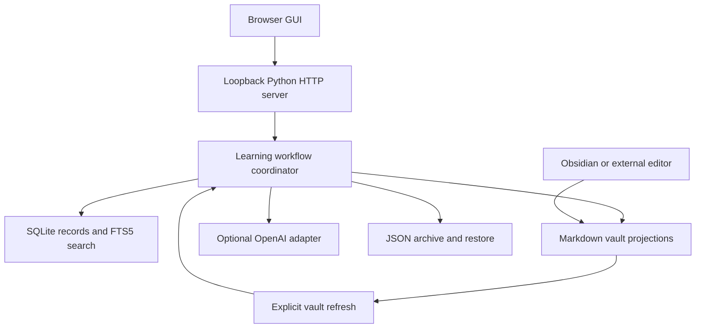

# Architecture: implemented v1

This describes the running application. Proposed future entities and integrations are in [the original data contract](DATA-CONTRACT.md) and [roadmap](ROADMAP.md).

## Runtime and boundaries

Python 3.11+ standard library handles HTTP, persistence, and optional HTTPS provider requests. The UI is vanilla JavaScript/CSS with no bundler or package installation. SQLite is the structured store; FTS5 is a rebuildable concept-note index. No background autonomous tools or code executor are present.

| File | Responsibility |
| --- | --- |
| `server.py` | Loopback HTTP endpoints, static assets, Host/Origin validation, request token, request-size boundary |
| `learning/app.py` | Teaching and assessment workflows, goals/resources, review and evidence rules, archive coordination |
| `learning/store.py` | SQLite records, Markdown synchronization, search, stable identifiers, conflict preservation |
| `learning/providers.py` | Bounded structured OpenAI requests and response validation |
| `web/` | Screens, local UI drafts, graph, and explicit actions |
| `content/examples.json` | Original illustrative concepts; no learner history |
| `tests/` | Persistence, workflow, provider, import/restore, and request-protection checks |

## Persistence and evidence

The default `private/records.sqlite3` stores workflow records as JSON payloads. The default `private/vault` contains Concepts, Sessions, and Conflicts. Markdown holds readable knowledge and session projections; the database preserves exact attempts, frozen references, assessment revisions, assistance, and planning history.

Answers are saved before provider evaluation so a failed request cannot erase work. Repeated submissions are retry-safe. Evidence derives from accepted assessments with origin and assistance recorded. Self-assessment is labeled. Revisions and disputes preserve prior judgments. Missing concept files do not erase attempts.

External note changes enter through **Refresh vault**. Stable IDs survive renames. Unknown frontmatter is preserved. The prerequisite editor checks cycles; arbitrary external prerequisite changes are not silently accepted. Concurrent file changes are preserved, and conflicting proposed content gets a separate note.

## Retrieval and optional AI

Search is lexical at concept-note granularity, not semantic embedding retrieval. Provider responses use concept IDs for provenance. ID validity does not establish claim correctness. There is no paragraph entailment evaluator.

Optional roles cover teaching, question generation, assessment, and lesson drafts. The process reads the API key from the environment; the browser never receives it. Cloud starts disabled and requires the user's setting. Selected notes and session context leave the machine when enabled. Responses API requests use bounded outputs, a 60-second timeout, a daily request cap, and `store: false`. A request cap is not a monetary budget.

## Recovery and local security

JSON export includes records, Markdown, checksums, schema version, and non-secret preferences. Restore validates paths and references, rejects conflicts, and makes a pre-restore snapshot. Cloud is disabled after restore. Non-Markdown attachments are excluded, and HTTP requests are capped at 12 MB; keep a filesystem backup for larger collections.

The server binds to loopback and checks Host/Origin and per-process request tokens. It assumes one trusted local user. It has no multi-user authentication or supported public-host deployment. Imported content is rendered as escaped text. See [security guidance](../SECURITY.md) and [setup/recovery](GETTING-STARTED.md).

## Validation boundary

Automated tests verify workflow and safety invariants. Provider tests use mocks; no paid live call or educational grading benchmark has been completed. Browser walkthroughs used synthetic records. Neither a passing suite nor evidence labels establish mastery or correct AI judgments. [Release details](RELEASE.md).
