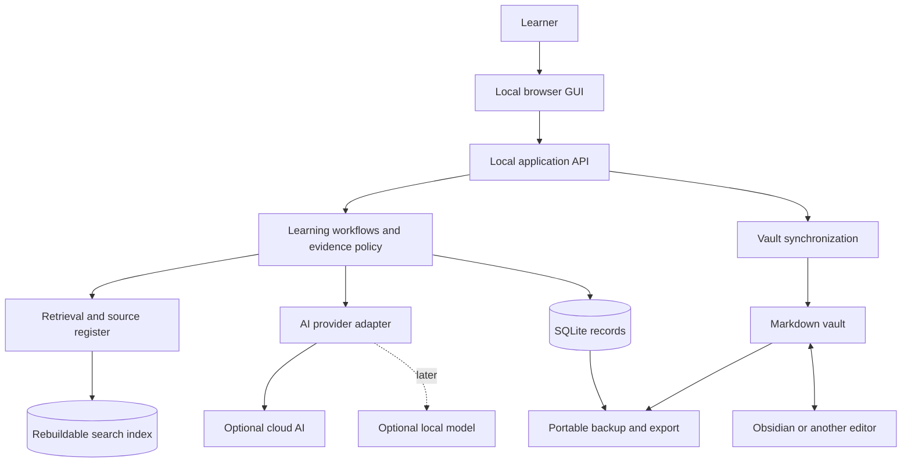

# AI Learning Companion: Project Plan

Status: planning baseline, 2026-10-06. This is a living plan. Record changed decisions and completed milestones as implementation proceeds.

Implementation update: the local v1 is now implemented. See [RELEASE.md](RELEASE.md) for actual scope, architecture changes, verification, and remaining optional integrations. Proposed choices below describe the original roadmap; they are not all current dependencies.

## 1. Purpose

Build a personal learning environment that can help you explore almost any subject, guide deliberate study, and preserve a trustworthy record of your learning. You should be able to say, “Teach me this,” “Quiz me,” “What do I already understand?” or “Continue where we stopped,” and get a useful response grounded in your materials and history.

“Learn everything” is the long-term direction. The system manages selected goals and an expanding map; it cannot enumerate all human knowledge or certify complete understanding. Its job is to reduce the burden of choosing, remembering, organizing, and reviewing.

The central distinction is between **a library of knowledge** and **evidence of your knowledge**. A note, watched video, or completed course records exposure. An explanation, solved problem, or delayed recall provides evidence. Both are valuable and remain separately visible.

## 2. Confirmed needs and working assumptions

| Item | Status | Consequence |
|---|---|---|
| Runs on the user's computer; cloud AI optional | Confirmed | Local storage and browser GUI; no hosted account required initially |
| Many subjects, courses, and external tools | Requested | Domain-neutral core plus subject-specific learning packs |
| Conversation, quizzes, theory answers, walkthroughs | Requested | Different activity types share one evidence model |
| Obsidian graphs and open representation | Requested | Markdown vault, stable IDs, typed relationships, documented exports |
| Discover knowledge the user cannot easily describe | Requested | Adaptive diagnostics, teach-back, and imported work samples |
| Durable history and continued learning | Requested | Recorded attempts, review queue, session resume, backups |
| One learner initially | Proposed | Avoid accounts, organizations, and collaboration overhead |
| Computing as first pilot | Provisional | Illustrative only; switch to the user's chosen subject |
| Text before live voice | Proposed | Validate the teaching loop before speech infrastructure |
| Open-source application | Proposed | Choose a license before distribution; portable personal data regardless |

No imported note or empty profile should be interpreted as proof of understanding. Missing evidence means unknown, not failure.

## 3. What a normal day looks like

1. Open Today and choose a time budget: for example, 10, 25, or 60 minutes.
2. See one suggested activity and a short explanation: “Review recursion because your last independent answer was a week ago.”
3. Choose review, continue a goal, ask a spontaneous question, or explore something new.
4. Work in a learning session with a visible objective and optional source panel.
5. Answer a question or complete a task. The tutor distinguishes hints from independent performance.
6. Receive specific feedback tied to your answer and an opportunity to correct it.
7. End with a short summary, linked concepts, evidence recorded, and a suggested next action.
8. Reopen later and resume the saved state, including an unanswered task or unfinished explanation.

The user can explore without assessment. Such sessions create notes and activity history but do not silently increase demonstrated proficiency.

## 4. Product principles

- **Ownership:** personal notes, attempts, and history remain exportable and readable.
- **Evidence:** every proficiency claim links to an observation and its conditions.
- **Low friction:** capture and link automatically; ask for decisions only where they matter.
- **Breadth with focus:** keep an exploration backlog while limiting active goals.
- **Agency:** explain recommendations and allow the user to override them.
- **Honesty:** distinguish source-grounded claims, general AI explanations, and uncertain judgments.
- **Continuity:** save useful session state and durable records; use summaries as navigation aids.
- **Accessibility:** keyboard support, readable equations and code, reduced motion, and graph alternatives.

## 5. Core workflows

### A. Discover what I already know

Start with goals, interests, time budget, and optional self-reported familiarity. Let the learner describe experience informally or attach existing notes and projects. Ask broad diagnostic questions, then narrow toward uncertain concepts.

Use three kinds of evidence: recall (“What does this mean?”), explanation (“Why does it work?”), and transfer (“Apply it to a new example”). Allow “I don't know,” “I need a hint,” “I know it but cannot explain it yet,” and “Skip.” Avoid a giant entrance exam.

After an initial short diagnostic, show a provisional profile with unknown areas, observed strengths, and a suggested starting point. Reassess through normal sessions. A fluent sentence alone does not establish practical skill; poor wording alone does not establish misunderstanding.

### B. Learn a new concept

The tutor retrieves relevant materials and prerequisite evidence, sets one small objective, explains with examples, and asks the learner to reason or demonstrate. If the learner struggles, branch into a prerequisite lesson or a different explanation. If the learner succeeds, offer a more demanding application.

Explanation choices include visual analogy, formal derivation, everyday example, worked problem, and code demonstration. Preferences affect presentation; they do not label the learner with a fixed learning style.

### C. Evaluate a long theory answer

Define a question, concept mapping, rubric, and expected evidence before revealing the question. Freeze that version for the attempt. Evaluate meaning and correctness rather than keyword matching.

Feedback must contain: what the answer got right; a quote or span supporting each judgment; what is missing; any misconception; uncertainty; and a concrete next exercise. Separate subject understanding from writing quality unless the objective is writing. Give credit to valid alternative explanations. Let the user dispute a judgment and preserve both original and revised assessments.

Suggested rubric dimensions: correctness, coverage, reasoning, example/application, and clarity. Use an ordinal 0–3 scale per dimension where appropriate; show the actual rubric. A single overall score cannot replace the feedback.

For ambiguous answers, ask a follow-up before making a strong inference. Self-reported familiarity, assisted attempts, and unassisted attempts remain distinct.

### D. Walk through a skill

Break a task into checkpoints: understand the objective, attempt a step, inspect feedback, explain the result, and complete a final independent task. Record hints and revealed solutions.

For programming, introduce executable checks only after isolated execution is available. For mathematics, check intermediate reasoning as well as the answer. For humanities, use evidence-based arguments and competing interpretations. For languages, add vocabulary, comprehension, composition, and later speech. For practical domains, use artifacts and reflection; do not imply that chat establishes physical competence.

### E. Bring an external course into the system

Register a course URL, syllabus, modules, objectives, and user-reported progress. Map modules to local concepts. After a course lesson, offer an independent comprehension check and create a personal summary.

Initial integration is manual links, pasted excerpts, and permitted imports. Automated enrollment, scraping, platform login, or progress synchronization depends on an available supported integration and comes later. Boot.dev and Coursera are experience references; no access to their services is assumed.

### F. Review and retain

Maintain a due queue with a configurable daily cap. Schedule questions from objectives and prior weaknesses, vary wording, and include fresh transfer tasks. Keep familiar question practice separate from evidence on unseen tasks.

Begin with a transparent interval ladder, such as 1, 3, 7, 14, and 30 days, adjusted by performance and hint use. These are prototype settings, not a validated predictive model. Later choose a more formal scheduler after enough real usage data exists. Overdue reviews must not cause an unmanageable backlog.

Retrieval practice has experimental support in the cited study; its result motivates active recall here, but does not validate our particular scheduler or scoring rules. [Study](https://pubmed.ncbi.nlm.nih.gov/21252317/)

### G. Resume and remember

Store the session objective, transcript, attempts, consulted sources, hints, current step, pending question, and a structured summary. On resume, retrieve the goal and relevant evidence; do not send the entire lifetime history to the AI.

Distinguish learner preferences, learning evidence, session state, and general notes. The user can inspect and correct each. “The AI remembers” must mean a record exists and is retrievable.

## 6. Capabilities by priority

| Capability | First usable release | Later expansion |
|---|---|---|
| Goals and paths | One active path, editable prerequisites | Multiple goals, cross-subject paths |
| Diagnostic assessment | Short-answer and teach-back | Work sample assessment, adaptive sampling |
| Tutor | Text, examples, limited hints | Voice, diagrams, richer simulations |
| Questions | Short answer, theory, simple multiple choice | Timed tests, mathematical input, oral exams |
| Practice | Guided checkpoints with user artifacts | Isolated code runner and domain tools |
| Knowledge library | Markdown notes, source register, links | PDFs, transcript imports, structured extraction |
| Retrieval | Full-text with filters and citations | Measured hybrid semantic retrieval |
| Proficiency | Evidence states per concept | Calibrated estimates and uncertainty |
| Review | Small due queue and interval ladder | Data-informed scheduling |
| External courses | Links and manual progress | Supported integrations |
| Graph | Linked concept detail and prerequisites | Interactive filtered graph and cross-domain exploration |
| Export | Markdown plus structured archive | Additional graph formats and integrations |
| AI | One configured provider adapter | Local model option and provider comparison |

## 7. Knowledge organization

Avoid creating a universal encyclopedia before learning starts. Use a small set of stable entity types:

- **Domain:** a broad organizing area, such as computing, biology, or history.
- **Concept:** an idea with an identifiable learning objective.
- **Skill:** an observable action, such as debugging a function or evaluating an argument.
- **Goal:** an intended outcome with a reason and optional deadline.
- **Learning path:** an ordered, editable set of objectives and prerequisites.
- **Resource:** an external or local source with provenance and access metadata.
- **Activity:** a lesson, reading, conversation, question, or task.
- **Attempt and assessment:** an actual learner response and its evaluation.
- **Session:** the surrounding learning interaction.
- **Review item:** a future recall or application opportunity.

Use typed relationships: requires, part_of, related_to, contrasts_with, applies_to, supported_by, and assessed_by. Stable IDs survive renaming. Concepts can belong to several domains. AI-proposed prerequisite links remain proposals until validated; related links do not imply prerequisites. Detect prerequisite cycles and explain suggested resolutions.

Obsidian's graph is a useful browse view over linked notes. Our application owns typed relationship semantics and evidence overlays. We should not assume that a visually dense graph proves learning. Obsidian stores notes as local Markdown files and supports YAML properties, making a portable vault feasible. [Storage](https://obsidian.md/help/data-storage), [properties](https://obsidian.md/help/properties)

## 8. Proficiency and evidence

Represent a concept using a small evidence-backed state:

| State | Meaning |
|---|---|
| Unknown | No sufficient observations |
| Encountered | Studied, discussed, or self-reported familiarity |
| Demonstrated with help | Correct performance using meaningful assistance |
| Demonstrated independently | Correct explanation or application without meaningful assistance |
| Retained | Independent success on a later, varied check |

Track recall, explanation, and application separately where the domain needs them. Include evidence count, recency, question difficulty, assistance, assessment confidence, and any unresolved disagreement. “Retained” is bounded to assessed objectives, not a permanent declaration of mastery.

Use versioned deterministic state rules first. For example, an independent correct attempt may establish demonstrated independence; a later correct, varied, independent check may establish retention. Repeated failures can show “review needed” while preserving earlier achievements. The exact delay threshold is a configurable policy documented during implementation. Never treat these states as a scientifically calibrated probability.

The system should be able to explain: “You explained recursion independently on October 6, but we have not yet tested delayed recall.” The date in this sentence is an example, not existing learner history.

## 9. Agentic AI design

Start with one bounded workflow coordinator using several versioned prompt roles. These are logical responsibilities, not separate autonomous processes or deployed agents.

| Role | Inputs | Produces |
|---|---|---|
| Planner | Goals, budget, prerequisites, evidence | A proposed path and next activity |
| Tutor | Objective, approved sources, session context | Explanation, hints, follow-up questions |
| Question author | Objectives, sources, difficulty, rubric policy | A validated question and frozen rubric |
| Evaluator | Frozen question/rubric and submitted answer | Structured feedback and uncertainty |
| Curator | Source metadata and draft notes | Proposed concepts, links, summaries |
| Session summarizer | Transcript and saved events | A concise resumable summary |

The application validates AI outputs and performs writes. AI grading does not directly rewrite the learner profile. A policy layer translates accepted evidence into proficiency states and review schedules.

Workflow: load context → choose bounded action → retrieve sources → invoke role → validate → show result → record evidence → propose next action. Set limits on tool calls, retries, tokens, and time. Stop on malformed output, missing evidence, repeated loops, or budget exhaustion with a recoverable UI state.

Prompt files must specify purpose, allowed tools, required output schema, citation expectations, uncertainty behavior, and examples. Version prompts and model configuration alongside each assessment. Imported documents are content, not instructions to tools. Keep reference answers out of the learner-facing payload before submission.

Use mock outputs during development to exercise the workflow without paid AI calls. A provider adapter permits changing models without rewriting the learning records. The first provider and any local model remain unselected.

## 10. RAG and source trust

Ingestion pipeline: register source → extract permitted text → preserve headings/page markers → generate stable chunks → index → retrieve → attach provenance → answer with citations.

First use lexical retrieval plus filters for domain, goal, source type, and approval status. SQLite FTS5 provides full-text search; choose semantic retrieval only after testing where lexical search fails. [FTS5 documentation](https://www.sqlite.org/fts5.html)

Later hybrid retrieval can combine lexical matches, embeddings, and a limited prerequisite neighborhood. Embeddings are a rebuildable index. Store source checksum, chunk ID, location, extractor version, and embedding configuration so updates invalidate stale results.

Separate external reference material, learner-authored notes, generated summaries, and historical feedback. A previous AI explanation is not automatically an authoritative source. Conflicting sources should remain visible. If source support is insufficient, say so and allow a clearly labeled general explanation.

Each generated citation must resolve to a real stored chunk or accessible source location. Citation presence alone is not proof of correctness; evaluation must check whether the cited passage supports the claim. Do not ingest every source into every answer, and do not let outdated retrieval certify current facts.

## 11. Proposed architecture

Use a modular monolith: one frontend, one local backend, one local database, and one vault. Avoid microservices and a dedicated graph database initially.



| Layer | Proposed choice | Reason and tradeoff |
|---|---|---|
| GUI | React + TypeScript with Vite | Flexible interactive teaching UI; requires a frontend toolchain |
| API and domain logic | Python + FastAPI | Convenient structured validation and later ingestion/AI tools; adds a second language |
| Durable records | SQLite | Low administration for one local learner; multi-device sync requires separate design |
| Knowledge files | Markdown with flat YAML frontmatter | Human-readable and compatible with Obsidian |
| Search | SQLite FTS5 initially | Simple lexical baseline before semantic infrastructure |
| Graph storage | Relationship tables plus note links | Adequate for concept navigation without a graph server |
| AI integration | Small provider interface | Avoid storing provider-specific responses as the only record |
| Desktop distribution | Local browser first | Validate product before a packaged desktop shell |

These are recommendations, not installed dependencies. The official docs describe React UI components, Vite project setup, and FastAPI's schema-based API features. Exact supported runtime versions and dependency locks must be checked at implementation. [React](https://react.dev/learn/describing-the-ui), [Vite](https://vite.dev/guide/), [FastAPI](https://fastapi.tiangolo.com/features/)

Keep domain policy independent of HTTP, prompts, and UI. Importers, AI providers, retrieval engines, and future practice runners are replaceable adapters. Public APIs and exports use explicit schema versions.

## 12. Data durability, privacy, and local operation

Canonical ownership and synchronization are detailed in [the data contract](DATA-CONTRACT.md). The important rule is to preserve both editable notes and non-reconstructible assessment history.

The database owns attempts, assessments, sessions, goals, scheduling, and accepted typed relationships. Markdown owns authored knowledge content and source notes. Generated proficiency frontmatter is a view with provenance, not the authority. Rebuilding an index is safe; deleting the assessment database without a structured backup loses evidence.

Store personal runtime data under ignored `private/` by default, with a user-selectable external location later. Keep code and synthetic fixtures publishable. A separate private vault repository may be used for personal versioning; publishing code must not publish the learner's vault.

Cloud calls require the user's configured provider and permission to send the selected context. Local storage does not make cloud inference private. Show what categories of data leave the computer and offer excluded folders/notes. Keep keys out of Git and logs; prefer an OS credential store in a distributable app.

Bind the initial backend to loopback, restrict allowed origins, and protect local write endpoints from unintended browser requests. Keep import paths within selected directories. Imported HTML is sanitized. Code execution later uses isolation, restricted resources, and no access to secrets or the vault.

Support transactional writes, atomic file replacement, retry-safe submissions, migrations, and backup manifests. A complete backup includes the database snapshot or lossless export, Markdown, permitted attachments, schema versions, and checksums. Test restoring into an empty directory. Retrying a request must not duplicate an attempt.

## 13. Repository layout

Only planning files exist now. Proposed eventual structure:

```text
README.md
docs/
  PROJECT-PLAN.md
  DATA-CONTRACT.md
  FIRST-BUILD.md
  design-plans/
  decisions/
apps/
  web/                  # browser GUI
  api/                  # local API and application entry point
packages/
  learning/             # domain policies and workflow state
  contracts/            # API/export schemas
  retrieval/            # indexing and source selection
  providers/            # AI adapters
prompts/                # versioned role instructions and examples
content/
  demo/                 # synthetic, clearly marked fixtures
  templates/            # reusable public templates
evals/                  # retrieval, grading, and workflow benchmarks
tests/                  # persistence, contracts, and end-to-end flows
scripts/                # setup, diagnostics, backup, restore
private/                # ignored actual learner data
  vault/
  records.sqlite3
  attachments/
```

Create packages only when code needs the boundary; the tree is guidance, not a requirement to fill empty directories.

## 14. Delivery roadmap and gates

Implementation proceeds by usable outcomes. These are scope units, not promised dates. Each milestone should be broken into reviewable tasks before work starts.

| Stage | Outcome | Dependencies | Exit gate |
|---|---|---|---|
| 0. Planning baseline | Shared product, data, and scope documents | This request | Local mode confirmed; open decisions recorded |
| 1. Durable first learning loop | One concept, question, answer, feedback, note, and resume | Provider choice or mock mode; frozen contracts | Restart preserves an independent attempt and source-linked feedback |
| 2. Discover and organize | Short diagnostic, editable goal/path, concept links | Stage 1 | Profile distinguishes unknown, exposure, and demonstrated ability |
| 3. Ground the tutor | Reliable ingestion, source register, retrieval | Stage 1 records and basic library | Citations resolve; weak retrieval produces an explicit insufficient-evidence state |
| 4. Retain and assess | Review queue, long answers, rubric disputes | Stages 2–3 | Delayed varied questions and revised grades preserve history |
| 5. Broaden learning | Course links, several domain packs, checkpoint exercises | Stages 2–4 | Same core supports a programming and non-programming objective |
| 6. Inspect and trust | Filtered graph, progress views, robust restore | Stable concepts/evidence | Each shown claim links to evidence; backup restores records and notes |
| 7. Rich interaction | Voice and selected isolated practice tools | Stable text flow and cost controls | Voice corrections prevent transcription errors becoming grading errors |
| 8. Distribution and optional sync | Installable release; sync only if requested | Tested restore, migration, and privacy controls | Clean install works; sync has an explicit conflict strategy |

Minimal backup/export and retrieval for a small approved fixture are required in Stage 1; later stages expand their robustness and breadth. Text feedback and a minimal rubric are required before advanced assessment. Do not postpone trustworthy persistence until the graph stage.

## 15. Validation and success criteria

Evaluate learning and reliability, not just whether the AI produces attractive responses.

**First-release acceptance:** a learner can complete a short session, explain the feedback, find the saved note and supporting attempt, close the app, reopen it, and continue. A provider failure cannot erase an answer. A retry cannot create duplicate evidence. Export/restore retains the attempt and source links.

**Assessment benchmark:** prepare a small reviewed set of correct, partial, wrong, alternative-wording, and ambiguous answers. Include assisted responses and attempted prompt injection. Compare AI judgments against reviewed rubric labels; track disagreement and severity. Require no invented learner quotes or evidence IDs in the fixed gate set and human review of every severe disagreement. Agreement alone does not establish educational validity.

**Retrieval benchmark:** use a fixture set with answerable, unanswerable, conflicting, and outdated-source queries. Measure whether supporting chunks are retrieved, whether answers cite them correctly, and whether the system abstains when support is absent. Choose numeric performance targets after inspecting the baseline, before accepting improvements.

**Product evaluation:** after a pilot week, ask whether the next action is understandable, recording takes little effort, feedback helps correction, and history is easy to inspect. Track voluntary completed sessions, delayed recall on comparable objectives, and grading disputes. Minutes watched and streaks are secondary activity metrics.

**Reliability checks:** Windows setup, restart/resume, same-answer retries, external note edits, source deletion, interrupted file writes, database migration, AI timeouts, invalid model output, cloud-off mode, backup restore, and keyboard-only use. Accessibility includes a list view for every graph operation.

## 16. Principal risks and responses

| Risk | Response |
|---|---|
| Scope grows faster than useful learning | Keep one complete learning loop as the first milestone; cap active goals |
| AI invents grades or flatters the learner | Frozen rubrics, cited answer spans, uncertainty, dispute history, evaluation fixtures |
| Familiarity is mistaken for understanding | Independent explanation/application and delayed varied checks |
| False precision in proficiency | Evidence states first; show conditions and recency |
| Elaborate graph becomes administrative work | Automatic draft links, small local neighborhoods, task-oriented navigation |
| Notes and app overwrite each other | Stable IDs, content hashes, field ownership, visible conflicts |
| Private history enters a public repository | Ignored runtime folder, synthetic fixtures, inspect before publishing |
| External platform integrations dominate development | Manual links first; supported adapters only when worthwhile |
| Cost or model failure interrupts studying | Per-session caps, mock mode, cached source retrieval, resumable failures |
| Review queue becomes overwhelming | Time budgets, queue caps, flexible priorities, overdue compression |
| Voice recognition distorts an answer | Confirmable transcripts and separate transcription confidence |
| Broad-domain grading misses disciplinary nuance | Domain packs and explicit limits on what each rubric measures |

## 17. Budget and operating costs

The local app does not need a hosting subscription for its first version. Optional cloud AI, embedding generation, speech, and paid courses may cost money; no prices are assumed here.

Record provider/model, token or usage counts when available, and estimated cost using a configurable price table with an update date. Set a user-chosen session and monthly cap; stop before additional paid work when the cap is reached. If usage cannot be estimated reliably, apply request/token limits and disclose that limitation.

Use small retrieved contexts, avoid repeated ingestion and repeated grading, and reserve stronger models for difficult evaluations where evidence shows they help. A local model may trade cloud cost for hardware requirements and setup work. Test quality on the same benchmark before adopting it.

## 18. Open decisions

Resolve the following incrementally; they do not prevent planning:

1. First subject and concrete learning goal; computing remains a provisional example.
2. AI provider, local-model interest, and spending cap before live calls.
3. English, Urdu, or mixed-language explanations; grading should not penalize language unnecessarily.
4. Existing Obsidian vault or a new vault; selected folders and migration policy.
5. What personal materials can be sent to cloud AI.
6. Whether voice is essential for the first usable version or a later convenience.
7. Application license before publishing; no license has been selected in this repository.
8. Need for mobile access or sync after the local workflow proves useful.

## 19. Decision log

- **2026-10-06:** user confirmed computer-based operation with optional cloud AI.
- **2026-10-06:** plan separates authored knowledge from demonstrated learner knowledge.
- **2026-10-06:** propose portable Markdown plus structured evidence storage and explicit exports.
- **2026-10-06:** propose a bounded coordinator before multiple autonomous agents.
- **2026-10-06:** defer semantic retrieval until a lexical baseline is evaluated.
- **2026-10-06:** use a subject-neutral design; pilot subject remains open.

## 20. Progress and discoveries

- [x] Inspect workspace: Git exists, no tracked application or prior commits.
- [x] Confirm local-first preference.
- [x] Write product, screen, data, and first-build planning documents.
- [ ] Select first learning objective and live AI configuration.
- [x] Implement and validate the first learning loop with offline and mocked-provider checks.
- [x] Add the local GUI, paths, course tracker, graph, reviews, and evidence history.
- [ ] Validate a live configured AI model and calibrate grading on reviewed real answers.

- **2026-10-06 implementation decision:** standard-library Python and browser JavaScript replace React/FastAPI to remove dependency setup for this local release.
- **2026-10-06 implementation decision:** MIT license selected; optional OpenAI adapter implemented, live provider/model still user-configured.

Discovery: an Obsidian vault alone cannot represent reliable assessment history. The app needs durable evidence records while preserving readable notes. Existing user knowledge is presently unknown; this plan creates no actual learner scores or study history.
