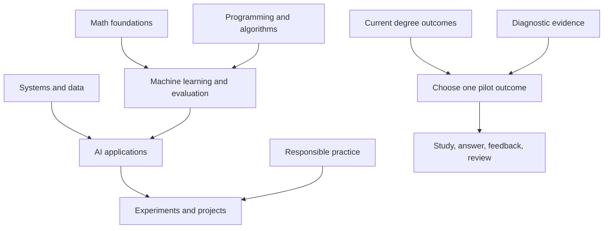

# Scope: CS and AI learning around a BSAI degree

Updated 2026-10-06. This is the current scope decision; the detailed original project plan remains a design baseline.

## Confirmed direction

The learner wants to learn as much computer science and AI as possible, centered on their BSAI degree. The app runs on their computer with optional cloud AI. Conversation, theory answers, quizzes, interactive practice, external courses, and durable records are requested. The application repository is public; personal study records belong in private storage.

University, country of study, semester, syllabus, exam dates, weekly time, budget, and existing proficiency are **unknown**. A timezone is not evidence of university jurisdiction. No course equivalence, placement, academic credit, or degree completion is claimed.

## Product boundary

Learning Atlas coordinates a personal learning loop: find an objective, study from chosen sources, explain or apply it, inspect feedback, preserve the original answer and assistance, and review later. Notes are a library; attempts are evidence. Courses supply instruction and assignments; the app links them to concepts and learner history.

The first target is one learner studying CS/AI on one local machine. A small, reliable workflow matters more than adding every tool. Research informs the direction, while actual learner use must determine whether it reduces management effort. [Initial research and sources](research/2026-10-06-scope-discovery.md).

## Proposed learning map

This grouping is our synthesis informed by [CS2023 knowledge areas](https://csed.acm.org/knowledge-areas/), not an official BSAI semester plan. Your university's current syllabus decides degree requirements.

| Track | Areas to map | Evidence to seek |
| --- | --- | --- |
| Degree alignment | Current modules, learning outcomes, labs, assignments, assessment dates | Match each syllabus outcome to sources, tasks, and existing evidence |
| Programming and tools | Python, assigned degree language, debugging, Git, shell, testing | Implement and debug a small program; explain design decisions |
| CS foundations | Data structures, algorithms, complexity, discrete mathematics, logic | Solve a new problem, justify correctness and cost |
| Mathematical foundations | Algebra, calculus, linear algebra, probability, statistics, optimization | Derive or calculate a result and explain assumptions |
| Systems and software | Architecture, operating systems, networks, databases, software engineering, security | Trace behavior, design a component, test failure cases |
| Core AI | Search, representation, reasoning, machine learning, evaluation | Compare approaches; implement a baseline; diagnose errors |
| AI depth | Deep learning, NLP, vision, generative AI, retrieval, agents | Run a reproducible experiment and assess limitations |
| Responsible practice | Ethics, privacy, accessibility, scientific writing, reproducibility | Explain tradeoffs and document evidence supporting a claim |
| Exploration | Robotics, graphics, distributed systems, theory, other interests | Small investigation before choosing a deeper path |

These are areas to investigate, not requirements to study simultaneously. Research papers become useful when you can understand their problem, assumptions, method, and evaluation.

The arrows describe broad preparation relationships. Concept-level prerequisites must be checked against the specific task; the diagram is not a rigid universal order.

## Choosing the first active scope

1. Gather the current semester's syllabus and existing work locally. Map three to five important outcomes before collecting more resources.
2. Pick one outcome with a visible artifact: explain and implement an algorithm, derive a model's loss, or build and evaluate a baseline classifier.
3. Select roughly 10–20 relevant concepts. This is a proposed management limit, not an evidence-based optimal number.
4. Attempt a small diagnostic without notes; record assistance and uncertainty. Use a fresh application task to check transfer.
5. Choose the smallest prerequisite gap that blocks the outcome. If the evidence supports readiness, skip repeated introductory study.
6. Keep one main learning track and one supporting foundation active. Capture other interests in a backlog and revisit after the pilot.

Suggested default **if no imminent degree requirement takes priority:** Python/debugging → a small tested data-processing program, supported by the mathematics its tasks require. If this is already comfortable, choose an ML baseline and data-leakage/evaluation task instead. No beginner label is assigned in advance.

## First pilot: six sessions over about two weeks

This is an optional experiment, not a commitment to a weekly schedule. Shorten sessions to the learner's available time.

| Session | Work | Record |
| --- | --- | --- |
| 1 | Map one degree outcome and gather a trusted source | Objective, sources, unknown prerequisites |
| 2 | Explain, solve, and apply before instruction | Original answers, assistance, confidence |
| 3 | Study the largest blocking gap and try again | Feedback, revisions, new attempt |
| 4 | Produce the small project or worked solution | Artifact location, tests/results, rationale |
| 5 | Attempt a changed question after a delay | Independent/assisted evidence, remaining uncertainty |
| 6 | Review workload and choose the next scope | Keep/change decision and reasons |

Use the existing Library, Goals, Study, Review, and resource tracker manually. Syllabus import, a placement engine, and automatic curriculum mapping are roadmap items.

## Proposed success criteria

- One concrete degree-related objective is mapped to sources and practice tasks.
- Original diagnostic answers survive restart and remain inspectable.
- The learner can identify a next action without reopening several planning tools.
- At least one fresh delayed task tests the chosen objective; wrong or uncertain answers remain useful evidence.
- A sampled feedback judgment is checked against a trusted reference or instructor feedback.
- A backup restores into a separate directory, with no private material committed publicly.

Track management time, completed meaningful tasks, disputed judgments, and reasons for skipping reviews. These criteria test usefulness; they do not certify mastery.

## Out of the current build

Degree certification, automated exam completion, executing learner code, unrestricted web agents, auto-purchasing courses, full platform synchronization, and a universal ontology are outside v1. Voice, PDF ingestion, semantic search, sandboxed code tasks, and local model adapters can be considered when a pilot demonstrates a need. See [roadmap](ROADMAP.md) and [actual release scope](RELEASE.md).

Next personalization inputs: university and syllabus version, semester and current modules, assessment priorities, preferred teaching language, weekly study time, and a sample of existing work. Keep personally identifying details and work samples in private storage; public issues should use generic examples.

The [starting resource shortlist](RESOURCES.md) offers official CS/AI course pages to choose from after this diagnostic. It is not an assigned workload.
